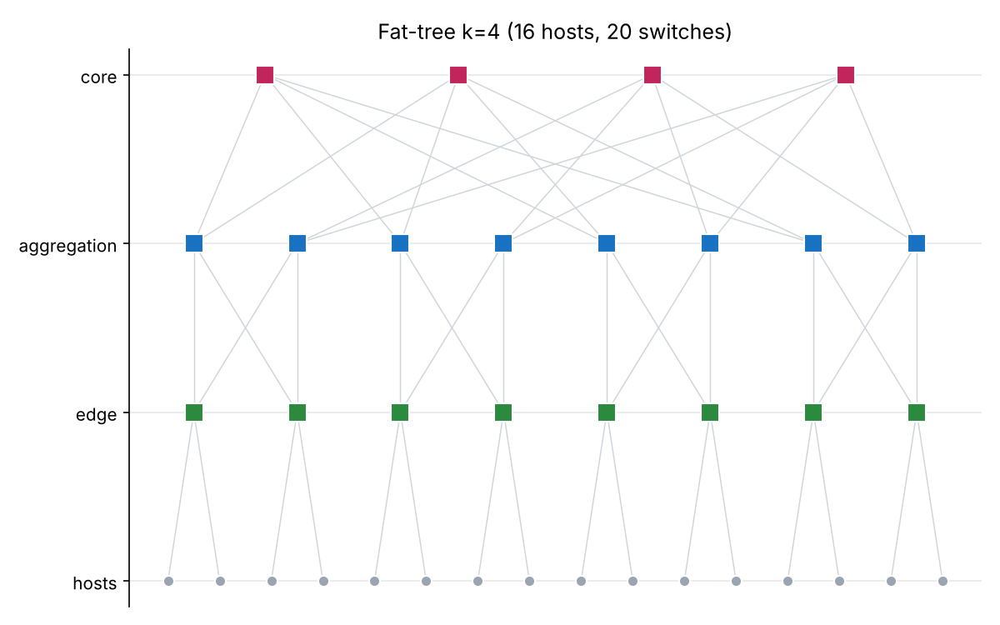
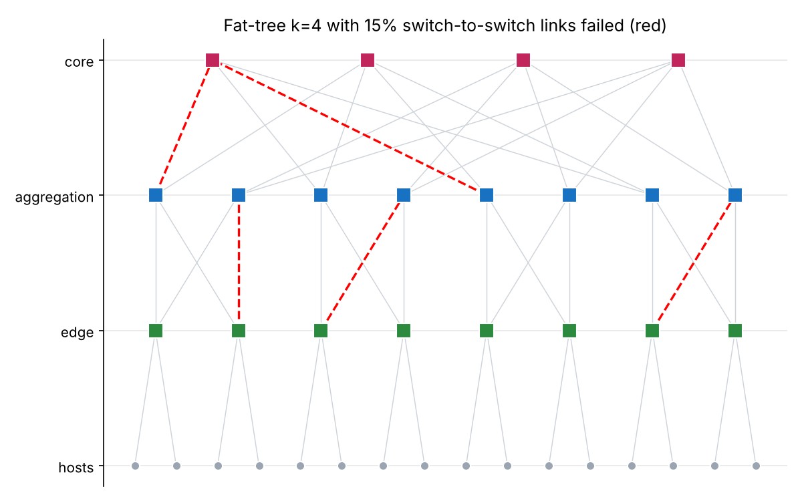
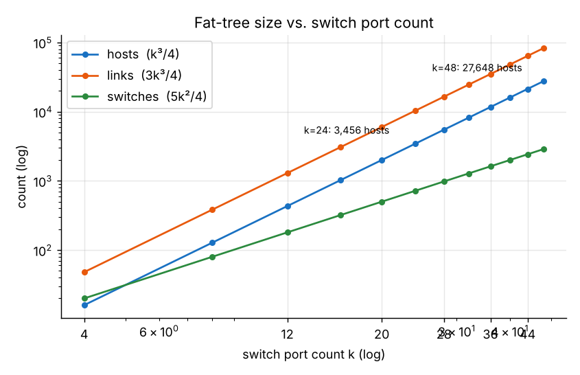
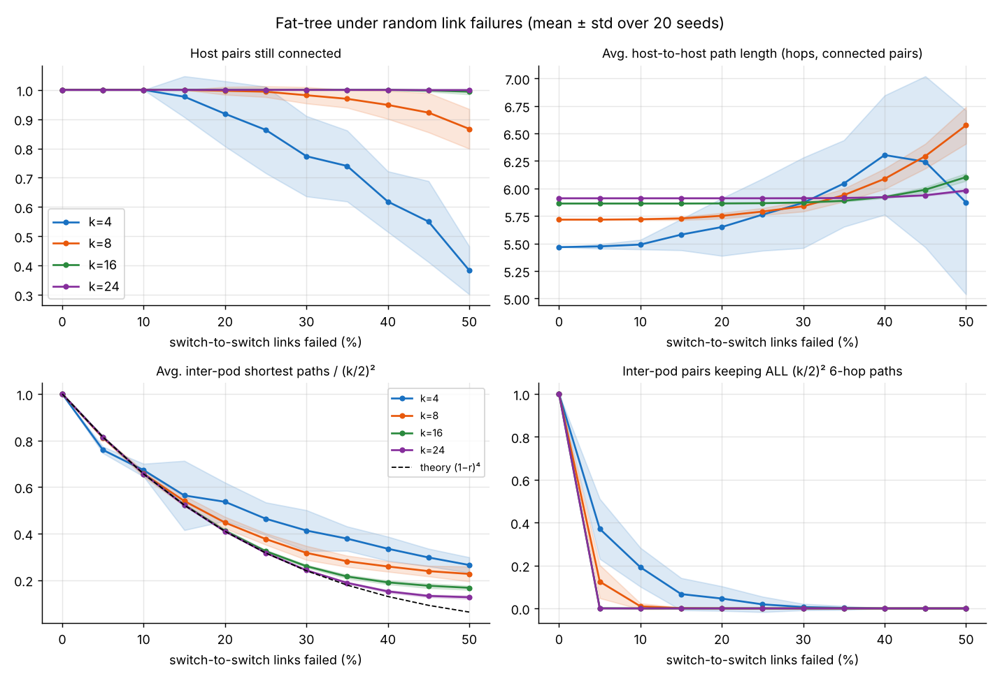
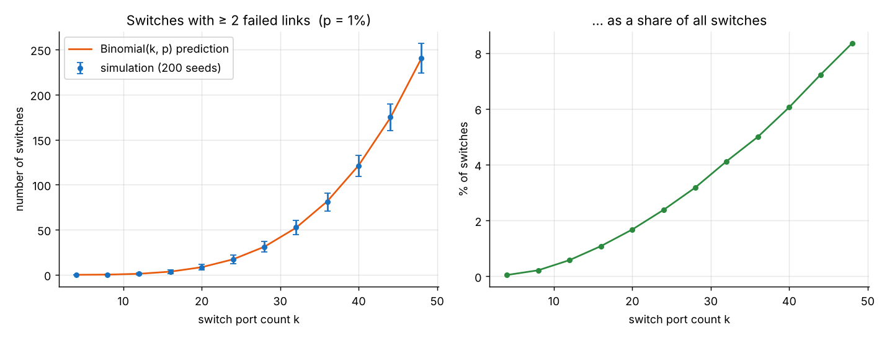

# HW1 — Fat-Tree Topology Generation and Analysis

Course 361.2.2460 — Communication Networks and AI for Data Centers, Semester A 2026/27.

A generator for the **k-ary fat-tree** of Al-Fares, Loukissas & Vahdat [1], with random
link-failure injection and three experiments (basic, intermediate, advanced) on how the
structure scales and how it degrades under failures.



---

## 1. Approach

### Topology (Al-Fares et al., Section 3)
For an even switch port count **k** the generator builds a three-tier tree in which every
switch is an identical k-port commodity switch:

| Element | Count | Wiring |
|---|---|---|
| Pods | k | — |
| Edge switches | k/2 per pod → k²/2 | k/2 ports down to hosts, k/2 ports up to **every** aggregation switch of its pod |
| Aggregation switches | k/2 per pod → k²/2 | k/2 ports down (all edges of the pod), k/2 ports up to one core group |
| Core switches | (k/2)² | one port to each of the k pods |
| Hosts | k³/4 | one link to an edge switch |
| Links | 3k³/4 | k³/4 per tier (host–edge, edge–agg, agg–core) |

Core switches are arranged as a (k/2)×(k/2) grid `(j, i)`. Aggregation switch number
`t ∈ [k/2, k−1]` of every pod connects to all k/2 cores of group `j = t − k/2 + 1`. Hence each
core reaches every pod exactly once and any two hosts in different pods are joined by exactly
**(k/2)² equal-length (6-hop) paths** — the path diversity that ECMP / two-level routing exploits.

Addresses follow the paper's scheme: pod switches `10.pod.switch.1`, core switches
`10.k.j.i`, hosts `10.pod.switch.ID` with `ID ∈ [2, k/2+1]`.

### Failure model
A *failure* removes a link (both directions). Two models are available:

* `exact` (default): exactly `round(rate × N)` links, sampled uniformly without replacement —
  the literal "percentage of failed links";
* `bernoulli`: each link fails independently with probability `rate` (used for the
  analytical comparison in Experiment 3).

By default only switch-to-switch links can fail; host links can be included with
`--include-host-links` (a failed host link just isolates one host, which says little about
the fabric itself).

### Metrics
`metrics.py` computes, **exactly** over all host pairs:

* fraction of host pairs that are still connected,
* average and maximum host-to-host shortest-path length (hops),
* average number of shortest paths between hosts in different pods (normalised by (k/2)²),
* fraction of inter-pod pairs that still have all (k/2)² 6-hop paths.

Number of shortest paths uses a BFS with path counting
(`count[v] += count[u]` whenever `dist[v] = dist[u] + 1`). Since every host hangs off one edge
switch, a host pair behaves like its pair of edge switches (path length + 2), so one BFS per
edge switch (k²/2 BFSs) on the switch graph, weighted by the number of live hosts on each edge,
gives the exact all-pairs result instead of k³/4 BFSs over hosts.

### Code layout
```
fattree.py        FatTree class (nodes, links, addressing, adjacency, JSON export) + sample_failures
metrics.py        BFS path counting, all-pairs host metrics, switches-with-multiple-failures (+ closed form)
generate.py       command-line generator (flags and/or JSON config)
draw.py           layered picture of a topology, failed links in red
experiments.py    runs the three experiments -> results/*.csv, results/*.png
tests/            pytest checks against the paper's formulas
config.example.json
```

---

## 2. Installation and usage

```bash
pip install -r requirements.txt          # matplotlib, numpy, pytest
python -m pytest -q tests                # 15 tests
python generate.py --k 4                 # intact k=4 fat-tree, prints counts + metrics
python generate.py --k 8 --failure-rate 0.1 --seed 1 --export out/k8.json --draw out/k8.png
python generate.py --config config.example.json            # same thing from a config file
python generate.py --config config.example.json --k 16     # CLI flags override the file
python experiments.py                    # all plots (~2 min); --quick for a fast smoke run
```

### Input parameters

| Flag / config key | Type | Default | Meaning |
|---|---|---|---|
| `--k` / `k` | even int ≥ 2 | 4 | switch port count; fixes the whole topology |
| `--failure-rate` / `failure_rate` | float in [0,1] | 0 | fraction of links that fail (0.05 = 5 %) |
| `--failure-model` / `failure_model` | `exact` \| `bernoulli` | exact | see failure model above |
| `--include-host-links` / `include_host_links` | bool | false | host–edge links may fail too |
| `--seed` / `seed` | int | none | makes the failure set reproducible |
| `--export` / `export` | path | none | JSON with nodes (kind, IP, pod) and links (type, failed flag) |
| `--draw` / `draw` | path | none | PNG drawing (readable for k ≤ 8) |
| `--no-metrics` / `metrics` | bool | true | skip path metrics |
| `--config` | path | none | JSON file with any of the keys above |

Invalid input (odd k, rate outside [0,1], unknown config key) is rejected with an error message.

Example output:
```
$ python generate.py --config config.example.json
Topology:      {"k": 8, "pods": 8, "hosts": 128, "edge_switches": 32, "aggregation_switches": 32, "core_switches": 16, "switches": 80, "links": 384}
Failed links:  13  (switches with >= 2 failed links: 4)
Metrics:       {"reachable_fraction": 1.0, "avg_path_length": 5.7165, "max_path_length": 6, ..., "ecmp_fraction": 0.8135, "full_ecmp_pair_fraction": 0.1629}
```



---

## 3. Results

All numbers below are produced by `python experiments.py` (seeds 0…N−1, fully reproducible);
raw data is in `results/*.csv`.

### Experiment 1 (basic) — network size vs. switch port count

**Setup.** Generate intact fat-trees for k = 4, 8, …, 48 and count hosts, switches and links.



| k | hosts | switches | links |
|---|---|---|---|
| 4 | 16 | 20 | 48 |
| 16 | 1,024 | 320 | 3,072 |
| 24 | 3,456 | 720 | 10,368 |
| 48 | 27,648 | 2,880 | 82,944 |

**Discussion.** The generator reproduces exactly k³/4 hosts, 5k²/4 switches and 3k³/4 links
(also asserted in the tests). On a log–log plot hosts and links have slope 3 and switches
slope 2: doubling the port count multiplies the number of hosts by 8 but switches only by 4.
With k = 48 commodity switches — the example of the paper — a single design connects
27,648 hosts at full bisection bandwidth. The price is cabling: the number of links grows like
the number of hosts (three links per host).

### Experiment 2 (advanced) — connectivity, path length and path diversity vs. failure rate

**Setup.** k ∈ {4, 8, 16, 24}; failure rate r = 0 %, 5 %, …, 50 % of switch-to-switch links
(`exact` model); 20 random failure sets per point; mean ± one standard deviation shown.
Metrics are exact over all host pairs.



Selected values (means over 20 seeds):

| k | r | connected pairs | avg path (hops) | inter-pod paths / (k/2)² | pairs with all paths |
|---|---|---|---|---|---|
| 4 | 10 % | 1.000 | 5.49 | 0.67 | 19 % |
| 4 | 30 % | 0.773 | 5.87 | 0.41 | 0.6 % |
| 8 | 5 % | 1.000 | 5.72 | 0.81 | 12 % |
| 8 | 50 % | 0.867 | 6.57 | 0.23 | 0 % |
| 16 | 5 % | 1.000 | 5.86 | 0.82 | 0.07 % |
| 24 | 50 % | 0.999 | 5.98 | 0.13 | 0 % |

**Discussion.**

1. *Connectivity is extremely robust, and more so for larger k.* For k ≥ 16 virtually every
   host pair stays connected even with half of the fabric links gone (99.4 % for k = 16, 99.9 %
   for k = 24). A pair is disconnected only if one edge switch loses **all** k/2 uplinks, or a
   whole set of aggregation/core links around it, and the probability of that falls
   exponentially with k/2. k = 4 (only 2 uplinks per edge switch) is the fragile exception.

2. *Path diversity, not connectivity, is what degrades.* The average number of surviving
   6-hop inter-pod paths follows **(1 − r)⁴** (dashed line): each such path uses 4 independent
   switch-to-switch links, and by linearity of expectation a fraction (1−r)⁴ of the (k/2)² paths
   survives, regardless of k. At 10 % failures only 66 % of the ECMP paths remain.
   Above ~30 % the measurement sits *above* the curve: when every 6-hop path between two
   edge switches is gone, the metric counts the paths of the new (longer) shortest length
   instead of zero. k = 4 also deviates, because with only 32 fabric links the `exact`
   model's sampling without replacement makes failures strongly dependent.

3. *Almost no pair keeps its full ECMP set.* All (k/2)² paths between two edge switches use
   k + k²/2 distinct links (k uplinks + 2·(k/2)² aggregation–core links), so the probability that
   none fails is ≈ (1 − r)^(k + k²/2): 0.95⁴⁰ ≈ 0.13 for k = 8 at 5 %, matching the measured
   12 %. Larger trees therefore lose "perfect" multipath almost immediately. Practical
   consequence: hash-based ECMP that is oblivious to failures would keep sending flows into dead
   or overloaded paths — this is exactly why the paper adds failure broadcast / flow
   rescheduling, and why later systems use adaptive load balancing.

4. *Path length barely changes — until it does, and beware of survivorship bias.*
   The intact average is 5.47 (k = 4) → 5.91 (k = 24) hops, approaching 6 because most pairs are
   inter-pod. Failures rarely lengthen paths, since some 6-hop path almost always survives; only
   at high rates do detours (8+ hops through another edge switch) appear (k = 8: 6.57 at 50 %).
   The average is taken over *connected* pairs only, so for k = 4 the curve even drops at 50 %:
   the long, fragile inter-pod pairs disconnect first and leave short intra-pod pairs in the
   sample. Path length alone is therefore a misleading robustness indicator.

### Experiment 3 (intermediate) — switches with ≥ 2 failed links at 1 % failure vs. k

**Setup.** k = 4, 8, …, 48; every link (host links included, so every switch uses k ports)
fails independently with p = 1 % (`bernoulli`); 200 seeds per k. The simulation is compared to
the closed form E = (5k²/4) · P[Binomial(k, p) ≥ 2].



| k | switches | simulated (mean) | Binomial prediction | % of switches |
|---|---|---|---|---|
| 8 | 80 | 0.18 | 0.22 | 0.2 % |
| 16 | 320 | 3.47 | 3.50 | 1.1 % |
| 32 | 1,280 | 52.7 | 52.1 | 4.1 % |
| 48 | 2,880 | 240.3 | 240.2 | 8.3 % |

**Discussion.** Simulation and theory agree within noise, which also validates the generator's
port wiring. For small p, P[≥2] ≈ (kp)²/2, so the *share* of switches with several failed links
grows ≈ k² and the *count* ≈ k⁴. The same 1 % per-link failure rate that is harmless for a k = 8
tree means that, with k = 48, about 240 switches (8 %) carry two or more dead ports at any time.
Bigger switches serve more hosts but concentrate more risk per box: operations (alarms,
replacement policy, routing around partially failed switches) must scale accordingly.

---

## 4. Limitations and possible extensions
* Failures are independent and uniform; real failures are correlated (a whole switch, a line
  card, a power domain). Switch failures could be added as a second failure type.
* Metrics are structural (graph-theoretic). A flow-level simulation (e.g. random permutation
  traffic with ECMP hashing) would turn "lost paths" into "lost throughput".
* Only shortest paths are counted; the paper's two-level routing tables could be generated from
  the same addressing to check which routes actually break.

## 5. References and AI usage
[1] M. Al-Fares, A. Loukissas, A. Vahdat, "A scalable, commodity data center network
architecture," *SIGCOMM Comput. Commun. Rev.*, 38(4), pp. 63–74, 2008,
[doi:10.1145/1402946.1402967](https://doi.org/10.1145/1402946.1402967).

**AI usage.** This assignment was developed with the help of Claude (Anthropic, model
Claude Opus 5.5) for code drafting, experiment design and README writing, as allowed by the
course. All code was run, tested and reviewed by me; I am responsible for and able to explain
every part of the submission.
